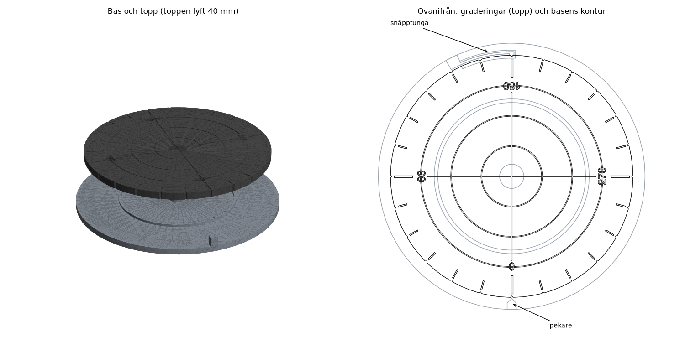

# Vridskiva för fotoskanning

En tvådelad, helt utskriven vridskiva för Skanna: delen (ca 50–150 mm) står på toppen, iPhonen står still på
stativet och du vrider toppen ett läge i taget mellan bilderna. Det finns inga köpdelar: inga lager, skruvar,
motor eller elektronik.



## Delar

| Fil | Del | Mått |
|---|---|---|
| `bas.3mf` / `.stl` / `.step` | Bas: platta Ø 176 × 5 mm med mitttapp Ø 16 mm, glidring Ø 100 mm (2 mm hög), pekare fram och en fjädrande snäpptunga bak | höjd 13 mm |
| `topp.3mf` / `.stl` / `.step` | Topp (skiva): Ø 160 × 6 mm, blint hål Ø 16,3 mm under, 24 V-hack i kanten, graderingar var 15°, siffrorna 0/90/180/270 och centreringskors med ringar (Ø 40/80/120) | |

`.3mf` och `.stl` ligger färdiga i utskriftsläge. `.step` är i sammansatt läge, för den som vill öppna den i ett CAD-program.

**Så fungerar den:** toppen vilar på basens glidring, som tar vikten och håller skivan plan. Tappen styr bara i sidled.
Tungan är en 35 mm lång och 1,4 mm tunn böjd vägg som står fritt i ett fönster i basplattan. Knoppen i tungans fria
ände går in 0,9 mm i hacken i toppens kant. Den trycker dessutom 0,2 mm extra mot hacket (förspänning) så att läget
centreras. Det blir ett tydligt men lätt klick, ungefär 0,6 N mot kanten.

Inköp (valfritt): 4 självhäftande gummifötter Ø 10 mm, som passar i urtagen (1 mm djupa) under basen.

## Utskrift (Bambu X2D, 0,4 mm munstycke)

- **Material:** PLA eller PETG. Ta gärna **matt svart** till toppen (t.ex. PLA Matte Charcoal): svart och matt ger
  minst reflexer och skuggor som stör fotogrammetrin. Basen kan ha vilken färg som helst.
- **Topp:** filen ligger redan med **ovansidan nedåt**. Skriv ut den på den texturerade PEI-plattan, så blir ovansidan
  jämnt matt och graveringarna skarpa. Hålet för tappen hamnar uppåt. Taket över hålet är en kort brygga som går bra
  utan stöd.
- **Bas:** som den ligger, med undersidan mot plattan. Tungan står fritt i sitt fönster och skrivs ut lodrätt, utan stöd.
- **Inga stöd** på någon av delarna.
- 0,2 mm lagerhöjd, 3 väggar och 15 % infill (gyroid). Tungan är massiv av sig själv: 1,4 mm är 3 väggar.
- Om det finns en "elephant foot"-kompensation: låt den vara på för basen, så att tungans nederkant inte smälter ihop
  med fönstrets kant.

## Montering

1. Kontrollera att tungan rör sig fritt. Peta den försiktigt utåt; den ska fjädra tillbaka. Skär bort eventuella
   trådar i fönstret.
2. Sätt fast gummifötterna i urtagen under basen.
3. Lägg toppen på basen så att tappen går in i hålet. Tryck tungan lite utåt med fingret om knoppen tar emot. Vrid tills
   det klickar.
4. Vrid tills **0** står vid pekaren. Det är läge 0.

## Användning och kalibrering

- 24 lägen, ett var 15°. Siffrorna visar hur långt toppen har vridits moturs sett ovanifrån: 90 vid pekaren = 90°.
- Ställ delen mitt på korset; ringarna hjälper dig att centrera.
- **Kontroll:** vrid ett helt varv och räkna 24 klick. Då ska 0 stå vid pekaren igen.
- Snurrar toppen trögt eller glappar den i sidled? Ändra `tappspel`. Klickar den för hårt eller för löst? Ändra
  `fjäder tjocklek` eller `knopp förspänning` (se nedan). Lite torrt PTFE-spray eller en droppe silikonolja på
  glidringen gör vridningen jämnare.

## Ändra mått

Öppna appen, skapa (eller öppna) ett projekt med mallen **Vridskiva** och klicka på ett värde i måttlistan för att
ändra det. Appen bygger då om delarna. Du kan också köra mallen direkt:

```sh
.venv/bin/python mallar/vridskiva.py <projektmapp>
```

Egna värden läses från `<projektmapp>/cad/parametrar-anvandare.json`, t.ex. `{"Vridskiva: tappspel": 0.4}`.

| Parameter (`Vridskiva: …`) | Standard | Vad den gör |
|---|---|---|
| antal lägen | 24 st | antal hack och gradmarkeringar |
| snäpplägen | 1 st | 1 = med snäpptunga, 0 = fritt vridbar (hacken i kanten finns kvar som index) |
| bas diameter / bas tjocklek | 176 / 5 mm | |
| topp diameter / topp tjocklek | 160 / 6 mm | |
| tapp diameter / tappspel | 16 / 0,3 mm | hålet i toppen = tapp + spel. Kärvar det: öka spelet; glappar det: minska det |
| glidring diameter / bredd / höjd | 100 / 2,4 / 2 mm | ringen som toppen vilar på |
| fjäder längd / fjäder tjocklek | 35 / 1,4 mm | längre eller tunnare ger lättare klick |
| hack djup | 0,9 mm | hur djupt knoppen griper |
| knopp förspänning | 0,2 mm | hur hårt knoppen trycker in i hacket när den sitter i läge |
| graderingsdjup | 0,6 mm | djup på streck och siffror |
| gummifot diameter / djup | 10 / 1 mm | urtag för fötterna |

## Inte provat än

- Ingen av delarna är utskriven och provad än. Både tappspelet (0,3 mm) och snäppkraften är beräknade, inte uppmätta.
- Med plast mot plast är vridningen något trögare än med ett kullager. För handvridning ska det räcka.
